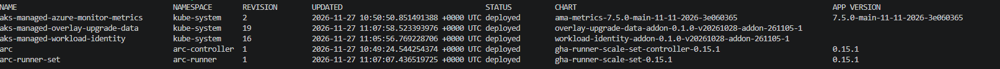
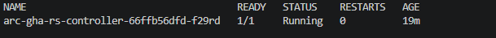

# Setting up self-hosted runners

The self-hosted workflows use `runs-on: Linux` or `runs-on: Windows`. These are default labels that GitHub adds when a runner is registered on that OS, so no custom labels are needed.

### Get the registration commands

1. Open the repository on GitHub and go to **Settings → Actions → Runners → New self-hosted runner**.
2. Pick the operating system (**Linux** or **Windows**) and the architecture (**x64**).
3. GitHub shows download and configure commands for the current runner version, with a registration token already filled in. The token expires after one hour.

The steps below follow those commands. Replace `<version>` and `<TOKEN>` with the values GitHub shows.

### Linux runner (Ubuntu)

1. **Install the prerequisites**, and let your user run Docker without `sudo`:

   ```bash
   sudo apt-get update
   sudo apt-get install -y git maven docker.io
   sudo usermod -aG docker $USER      # log out and back in for this to apply
   ```

2. **Download and extract the runner.** Use a normal user, not `root`; `config.sh` refuses to run as root.

   ```bash
   mkdir ~/actions-runner && cd ~/actions-runner
   curl -o actions-runner-linux-x64-<version>.tar.gz -L \
     https://github.com/actions/runner/releases/download/v<version>/actions-runner-linux-x64-<version>.tar.gz
   tar xzf ./actions-runner-linux-x64-<version>.tar.gz
   ```

3. **Register the runner** with this repository. Press Enter to accept the default runner group and labels (`self-hosted`, `Linux`, `X64`).

   ```bash
   ./config.sh --url https://github.com/charanaswanthss/githubActions --token <TOKEN> --name linux-runner-01
   ```

4. **Start the runner.** Use either option:

   ```bash
   ./run.sh                     # in the foreground, for a quick test (stop with Ctrl+C)

   sudo ./svc.sh install        # or as a systemd service that starts on boot
   sudo ./svc.sh start
   sudo ./svc.sh status
   ```

5. *(Optional, for the Nexus workflow)* run Nexus locally:

   ```bash
   docker run -d --name nexus -p 8081:8081 sonatype/nexus3
   docker exec nexus cat /nexus-data/admin.password   # initial admin password
   ```

   Then add `NEXUS_USERNAME` and `NEXUS_PASSWORD` as repository secrets.

> If you add the runner user to the `docker` group after installing the service, restart the service (`sudo ./svc.sh stop && sudo ./svc.sh start`) so it picks up the new group.

### Windows runner

Run these steps in **PowerShell as Administrator**.

1. **Install the prerequisites.** This example uses [Chocolatey](https://chocolatey.org/install):

   ```powershell
   choco install -y git maven
   ```

   Open a new PowerShell window afterwards so `git` and `mvn` are on `PATH`.

2. **Download and extract the runner.** Use a short path near the drive root, such as `C:\actions-runner`, to avoid Windows path-length and permission problems.

   ```powershell
   mkdir C:\actions-runner; cd C:\actions-runner
   Invoke-WebRequest -Uri https://github.com/actions/runner/releases/download/v<version>/actions-runner-win-x64-<version>.zip -OutFile actions-runner-win-x64-<version>.zip
   Add-Type -AssemblyName System.IO.Compression.FileSystem
   [System.IO.Compression.ZipFile]::ExtractToDirectory("$PWD\actions-runner-win-x64-<version>.zip", "$PWD")
   ```

3. **Register the runner** with this repository. When prompted *"Would you like to run the runner as service?"*, answer **Y** to install it as a Windows service that starts on boot.

   ```powershell
   .\config.cmd --url https://github.com/charanaswanthss/githubActions --token <TOKEN> --name windows-runner-01
   ```

4. **Start the runner.** If you didn't install it as a service, run it in the foreground:

   ```powershell
   .\run.cmd
   ```

   If it runs as a service, manage it with `Get-Service "actions.runner.*"` and `Restart-Service "actions.runner.*"`. Restart it after installing new tools so it picks up the updated `PATH`.

### Verify the runners

Under **Settings → Actions → Runners**, each runner should show as **Idle** with its labels. Start a self-hosted workflow from the **Actions** tab. The job log's *Set up job* step shows which runner picked it up.

### Remove a runner

Get a removal token from the runner's page under **Settings → Actions → Runners**, then run:

```bash
sudo ./svc.sh stop && sudo ./svc.sh uninstall              # Linux, if installed as a service
./config.sh remove --token <TOKEN>                         # Linux
.\config.cmd remove --token <TOKEN>                        # Windows (also removes the service)
```

### K8s runner

1. Github Apps Installation
- Settings -> Developer Settings -> Install App
-   Github App name :
    Homepage URL : https://github.com
    Uncheck Wehbhool URL
    Actions - Read Only
    Administartion - Read And Write 
- Install
- Get AppID and Cleint ID
- generate Private key and save it
Install and get Installation ID Example: https://github.com/settings/installations/186458135

2. AKS cluster is created using the terraform scripts in <repo_link>
3. Create tqwo namespace. one for controller and another for runner
    kubectl create namespace arc-controller
    kubectl create namespace arc-runner
4. Install Actions Runner Controller
    helm install arc \
    --namespace arc-controller \
    oci://ghcr.io/actions/actions-runner-controller-charts/gha-runner-scale-set-controller
5. Install Runner scale set
    Create secret
    az aks command invoke --resource-group my-demo-dev --name my-demo-aks-dev --command "kubectl create secret generic arc-github-app -n arc-runner --from-literal=github_app_id=5950754 --from-literal=github_app_installation_id=186458135 --from-file=github_app_private_key=poc.pem" --file poc.pem


        helm install arc-runner-set --namespace arc-runner --set githubConfigUrl="https://github.com/charanaswanth/githubActions" --set githubConfigSecret=arc-github-app --set minRunners=0 --set maxRunners=2 oci://ghcr.io/actions/actions-runner-controller-charts/gha-runner-scale-set

helm list -A


kubectl get pods -n arc-controller

kubectl get pods -n arc-runner

name: Actions Runner Controller Demo
on:
  workflow_dispatch:

jobs:
  Explore-GitHub-Actions:
    # You need to use the INSTALLATION_NAME from the previous step
    runs-on: arc-runner-set
    steps:
    - run: echo "🎉 This job uses runner scale set runners!"
