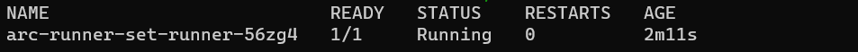
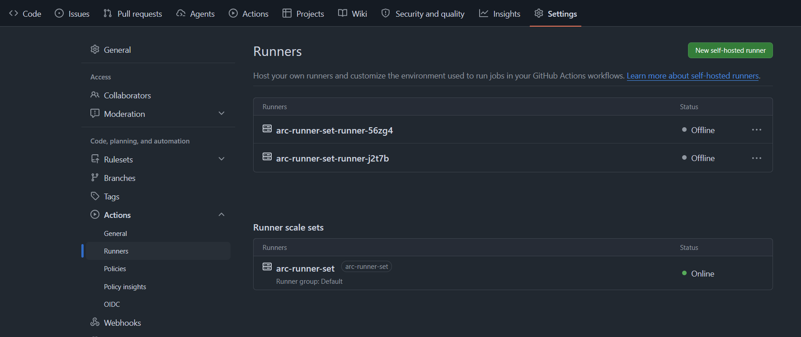
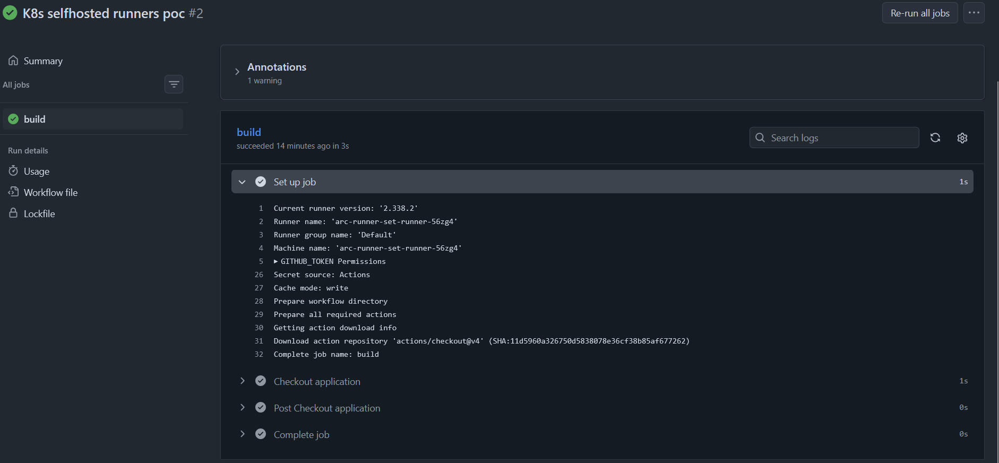

# Setting up self-hosted runners

This guide covers two ways to run this repository's self-hosted workflows:

- [**VM runners (Linux and Windows)**](#vm-runners-linux-and-windows): the runner application installed directly on a machine. Used by the `Linux` and `Windows` workflows.
- [**Kubernetes runners (Actions Runner Controller)**](#kubernetes-runners-actions-runner-controller): runner pods that ARC creates on demand in an AKS cluster. Used by the K8s workflow.

---

## VM runners (Linux and Windows)

The self-hosted workflows use `runs-on: Linux` or `runs-on: Windows`. These are default labels that GitHub adds when a runner is registered on that OS, so no custom labels are needed.

### Get the registration commands

1. Open the repository on GitHub and go to **Settings → Actions → Runners → New self-hosted runner**.
2. Pick the operating system (**Linux** or **Windows**) and the architecture (**x64**).
3. GitHub shows download and configure commands for the current runner version, with a registration token already filled in. The token expires after one hour.

The steps below follow those commands. Replace `<version>` and `<TOKEN>` with the values GitHub shows.

### Linux runner (Ubuntu)

1. **Install the prerequisites**, and let your user run Docker without `sudo`:

   ```bash
   sudo apt-get update
   sudo apt-get install -y git maven docker.io
   sudo usermod -aG docker $USER      # log out and back in for this to apply
   ```

2. **Download and extract the runner.** Use a normal user, not `root`; `config.sh` refuses to run as root.

   ```bash
   mkdir ~/actions-runner && cd ~/actions-runner
   curl -o actions-runner-linux-x64-<version>.tar.gz -L \
     https://github.com/actions/runner/releases/download/v<version>/actions-runner-linux-x64-<version>.tar.gz
   tar xzf ./actions-runner-linux-x64-<version>.tar.gz
   ```

3. **Register the runner** with this repository. Press Enter to accept the default runner group and labels (`self-hosted`, `Linux`, `X64`).

   ```bash
   ./config.sh --url https://github.com/charanaswanth/gitHubAction --token <TOKEN> --name linux-runner-01
   ```

4. **Start the runner.** Use either option:

   ```bash
   ./run.sh                     # in the foreground, for a quick test (stop with Ctrl+C)

   sudo ./svc.sh install        # or as a systemd service that starts on boot
   sudo ./svc.sh start
   sudo ./svc.sh status
   ```

5. *(Optional, for the Nexus workflow)* run Nexus locally:

   ```bash
   docker run -d --name nexus -p 8081:8081 sonatype/nexus3
   docker exec nexus cat /nexus-data/admin.password   # initial admin password
   ```

   Then add `NEXUS_USERNAME` and `NEXUS_PASSWORD` as repository secrets.

> If you add the runner user to the `docker` group after installing the service, restart the service (`sudo ./svc.sh stop && sudo ./svc.sh start`) so it picks up the new group.

### Windows runner

Run these steps in **PowerShell as Administrator**.

1. **Install the prerequisites.** This example uses [Chocolatey](https://chocolatey.org/install):

   ```powershell
   choco install -y git maven
   ```

   Open a new PowerShell window afterwards so `git` and `mvn` are on `PATH`.

2. **Download and extract the runner.** Use a short path near the drive root, such as `C:\actions-runner`, to avoid Windows path-length and permission problems.

   ```powershell
   mkdir C:\actions-runner; cd C:\actions-runner
   Invoke-WebRequest -Uri https://github.com/actions/runner/releases/download/v<version>/actions-runner-win-x64-<version>.zip -OutFile actions-runner-win-x64-<version>.zip
   Add-Type -AssemblyName System.IO.Compression.FileSystem
   [System.IO.Compression.ZipFile]::ExtractToDirectory("$PWD\actions-runner-win-x64-<version>.zip", "$PWD")
   ```

3. **Register the runner** with this repository. When prompted *"Would you like to run the runner as service?"*, answer **Y** to install it as a Windows service that starts on boot.

   ```powershell
   .\config.cmd --url https://github.com/charanaswanth/gitHubAction --token <TOKEN> --name windows-runner-01
   ```

4. **Start the runner.** If you didn't install it as a service, run it in the foreground:

   ```powershell
   .\run.cmd
   ```

   If it runs as a service, manage it with `Get-Service "actions.runner.*"` and `Restart-Service "actions.runner.*"`. Restart it after installing new tools so it picks up the updated `PATH`.

### Verify the runners

Under **Settings → Actions → Runners**, each runner should show as **Idle** with its labels. Start a self-hosted workflow from the **Actions** tab. The job log's *Set up job* step shows which runner picked it up.

### Remove a runner

Get a removal token from the runner's page under **Settings → Actions → Runners**, then run:

```bash
sudo ./svc.sh stop && sudo ./svc.sh uninstall              # Linux, if installed as a service
./config.sh remove --token <TOKEN>                         # Linux
.\config.cmd remove --token <TOKEN>                        # Windows (also removes the service)
```

---

## Kubernetes runners (Actions Runner Controller)

[Actions Runner Controller (ARC)](https://docs.github.com/en/actions/hosting-your-own-runners/managing-self-hosted-runners-with-actions-runner-controller/about-actions-runner-controller) runs GitHub Actions runners as pods in a Kubernetes cluster. Instead of a long-lived machine, each job gets a fresh, ephemeral runner pod that is deleted when the job finishes.

### How it works

ARC is installed as two Helm charts:

| Component | Helm release | Namespace | Role |
|---|---|---|---|
| Controller | `arc` | `arc-controller` | Watches runner scale sets and creates the listener and runner pods. |
| Runner scale set | `arc-runner-set` | `arc-runner` | Registers with this repository and defines the runner pod (image, min/max count). |

1. The scale set signs in to GitHub with a **GitHub App** and registers itself as a runner scale set on the repository.
2. A **listener pod** (in `arc-controller`) holds a long-poll connection to GitHub and waits for jobs.
3. When a workflow job has `runs-on: arc-runner-set`, the listener asks the controller for a runner, and the controller starts a **runner pod** in `arc-runner`.
4. The runner pod runs the job, then exits and is removed. The scale set keeps between `minRunners` and `maxRunners` pods.

The **Helm release name of the scale set is the label** that workflows use in `runs-on`. Renaming the release changes the label.

### Values used in this POC

| Item | Value |
|---|---|
| AKS resource group / cluster | `my-demo-dev` / `my-demo-aks-dev` |
| ARC chart version | `0.15.1` |
| Controller namespace / release | `arc-controller` / `arc` |
| Runner namespace / release (`runs-on` label) | `arc-runner` / `arc-runner-set` |
| GitHub App secret | `arc-github-app` (in `arc-runner`) |
| Runners | `minRunners=1`, `maxRunners=2` |
| Custom runner image | `mydemoacr97.azurecr.io/arc-runner:1.0.0` |
| Repository | `https://github.com/charanaswanth/gitHubAction` |

### Prerequisites

- An AKS cluster. In this POC it is created with the Terraform scripts in `https://github.com/charanaswanth/terraform/tree/master/AzureKubernetesService`.
- [Azure CLI](https://learn.microsoft.com/cli/azure/install-azure-cli), plus `kubectl` and [Helm 3](https://helm.sh/docs/intro/install/) if you reach the cluster API directly.
- Admin access to this repository, to create and install the GitHub App.

> **Private AKS clusters.** If the cluster's API server isn't reachable from your machine, run each `kubectl` and `helm` command below through `az aks command invoke`, which runs it inside the cluster:
>
> ```bash
> az aks command invoke --resource-group my-demo-dev --name my-demo-aks-dev \
>   --command "<kubectl or helm command>"
> ```
>
> Add `--file <local-file>` to upload a file the command needs (step 4 does this for the private key). For a public cluster, get credentials once with `az aks get-credentials --resource-group my-demo-dev --name my-demo-aks-dev` and run the commands directly.

### 1. Create and install a GitHub App

ARC authenticates to GitHub with a GitHub App. An App is preferred over a personal access token because it isn't tied to a user and its tokens are short-lived.

1. Go to your profile **Settings → Developer settings → GitHub Apps → New GitHub App**.
2. Fill in the form:
   - **GitHub App name**: any unique name, for example `arc-runners-<your-user>`.
   - **Homepage URL**: `https://github.com` (any URL works; it isn't used).
   - **Webhook**: clear the **Active** checkbox. ARC doesn't use webhooks.
   - **Repository permissions**:
     - **Actions**: Read-only
     - **Administration**: Read and write *(needed to register runners)*
     - **Metadata**: Read-only *(selected automatically)*
   - **Where can this GitHub App be installed?**: *Only on this account*.
3. Click **Create GitHub App**. On the app's **General** page, note the **App ID**.
4. Under **Private keys**, click **Generate a private key**. A `.pem` file downloads. Store it securely and never commit it to the repository.
5. Click **Install App** in the left menu, choose your account, select **Only select repositories → gitHubAction**, and click **Install**.
6. After installing, the browser shows a URL such as `https://github.com/settings/installations/186458135`. The number at the end is the **Installation ID**.

You now have the three values ARC needs: **App ID**, **Installation ID** and the **private key file**.

### 2. Create the namespaces

Keep the controller and the runners in separate namespaces:

```bash
kubectl create namespace arc-controller
kubectl create namespace arc-runner
```

### 3. Install the controller

```bash
helm install arc \
  --namespace arc-controller \
  --version 0.15.1 \
  oci://ghcr.io/actions/actions-runner-controller-charts/gha-runner-scale-set-controller
```

Check that the controller pod is running:

```bash
kubectl get pods -n arc-controller
```


### 4. Store the GitHub App credentials as a secret

The secret must be in the **runner** namespace (`arc-runner`), and the key names must be exactly `github_app_id`, `github_app_installation_id` and `github_app_private_key`.

```bash
kubectl create secret generic arc-github-app \
  --namespace arc-runner \
  --from-literal=github_app_id=<APP_ID> \
  --from-literal=github_app_installation_id=<INSTALLATION_ID> \
  --from-file=github_app_private_key=<path-to-private-key>.pem
```

### 5. Install the runner scale set

```bash
helm install arc-runner-set \
  --namespace arc-runner \
  --version 0.15.1 \
  --set githubConfigUrl="https://github.com/charanaswanth/gitHubAction" \
  --set githubConfigSecret=arc-github-app \
  --set minRunners=1 \
  --set maxRunners=2 \
  oci://ghcr.io/actions/actions-runner-controller-charts/gha-runner-scale-set
```

| Setting | Meaning |
|---|---|
| `arc-runner-set` (release name) | The scale set name, and the label used in `runs-on`. |
| `githubConfigUrl` | Where runners register. A repository URL registers them for this repository only. |
| `githubConfigSecret` | The secret created in step 4. |
| `minRunners` | Idle runner pods kept ready. `1` avoids a cold start; `0` saves resources. |
| `maxRunners` | Maximum runner pods, so the maximum number of jobs running at once. |

Keep the controller and scale set charts on the **same version**.

### 6. Verify the installation

Both Helm releases should show as `deployed`:

```bash
helm list -A
```


With `minRunners=1`, one idle runner pod is running:

```bash
kubectl get pods -n arc-runner
```



In the repository, go to **Settings → Actions → Runners**. The scale set `arc-runner-set` appears under **Runner scale sets** with status **Online**. Individual runner pods also appear in the **Runners** list; they show as offline once their pod has gone, which is expected for ephemeral runners.



### 7. Run a workflow on the Kubernetes runners

Set `runs-on` to the scale set name. [buildWorkflow _selfHosted_k8s.yml](.github/workflows/buildWorkflow%20_selfHosted_k8s.yml) is a minimal POC workflow that checks out the repository on an ARC runner:



Start it from the **Actions** tab. While it runs, `kubectl get pods -n arc-runner` shows the runner pod that picked up the job, and the job log's *Set up job* step shows the same runner name.

### Use a custom runner image

- The default image `ghcr.io/actions/actions-runner`, contains only the runner and a few basic tools. To install other custom tools either extend with the official runner image `ghcr.io/actions/actions-runner:<version>` or create new DockerImage.

- Update the arc-runner helm with the custom image

   ```bash
   helm upgrade --install arc-runner-set \
     --namespace arc-runner \
     --version 0.15.1 \
     --set githubConfigUrl="https://github.com/charanaswanth/gitHubAction" \
     --set githubConfigSecret=arc-github-app \
     --set minRunners=1 \
     --set maxRunners=2 \
     --set "template.spec.containers[0].name=runner" \
     --set "template.spec.containers[0].image=mydemoacr97.azurecr.io/arc-runner:1.0.0" \
     --set "template.spec.containers[0].command[0]=/home/runner/run.sh" \
     oci://ghcr.io/actions/actions-runner-controller-charts/gha-runner-scale-set
   ```

- Use yaml file to upload multiple configurations such as cpu and memory configuration

   ```yaml
   githubConfigUrl: "https://github.com/charanaswanth/gitHubAction"
   githubConfigSecret: arc-github-app
   minRunners: 1
   maxRunners: 2
   template:
      spec:
         containers:
            - name: runner
            image: mydemoacr97.azurecr.io/arc-runner:1.0.0
            command: ["/home/runner/run.sh"]
            resources:
               requests:
                  cpu: 500m
                  memory: 1Gi
               limits:
                  cpu: "1"
                  memory: 2Gi
   ```

   ```bash
   helm upgrade --install arc-runner-set \
     --namespace arc-runner \
     -f values.yaml \
     oci://ghcr.io/actions/actions-runner-controller-charts/gha-runner-scale-set
   ```

### Remove ARC

Uninstall the scale set **before** the controller, so the controller can deregister the runners from GitHub and clean up their pods:

```bash
helm uninstall arc-runner-set -n arc-runner
helm uninstall arc -n arc-controller
kubectl delete namespace arc-runner arc-controller
```

Then, if the GitHub App is no longer needed, uninstall it under **Settings → Applications → Installed GitHub Apps**, and delete it under **Developer settings → GitHub Apps**.
